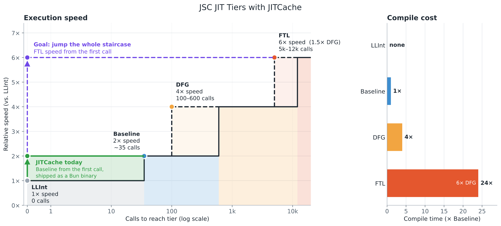

# JITCache benches

The beta, run on an Oracle Ampere A1 (Neoverse-N1, 4 OCPU, 24 GB) with the released aarch64 binary of v1.4.2-jitcache-beta.1, 2026-10-15. Each case is a small app in `apps/`, called the way a serverless platform calls a function, with the same request every call. A producer served 100 calls and saved the JIT code with delta(vm) at exit, and a processes with JITCache read its from a warm page cache (assuming you will be downloading it). Every Bun process ran pinned to one CPU. Times are the median of 30 processes without and with JITCache.

| case | request 3 | requests 2-35 | requests 2-500 | startup + request 1 |
|---|---|---|---|---|
| hono | 19% faster | 17% faster | 16% faster | 53.0 → 48.3 ms |
| elysia | same | 24% faster | 4% faster | 105 → 90.3 ms |
| react-ssr | 79% faster | 12% faster | 3% faster | 47.4 → 31.0 ms |
| preact-ssr | 18% faster | 3% faster | 2% faster | 16.5 → 15.4 ms |
| webhook | 30% faster | 50% faster | 19% faster | 50.0 → 45.7 ms |

# Currenty state

# difference

Requests 2-35 sum the 34 calls after the first in each 50-call process, and requests 2-500 every call after the first in each 500-call process. Times are in ms

Request 3, third call alone:

| case | without (ms) | with (ms) | faster |
|---|---|---|---|
| hono | 0.043 | 0.035 | 19% |
| elysia | 0.154 | 0.154 | 0% |
| react-ssr | 3.82 | 0.81 | 79% |
| preact-ssr | 0.643 | 0.528 | 18% |
| webhook | 0.066 | 0.046 | 30% |

Requests 2-35:

| case | without (ms) | with (ms) | faster |
|---|---|---|---|
| hono | 1.23 | 1.03 | 17% |
| elysia | 10.4 | 7.92 | 24% |
| react-ssr | 52.7 | 46.5 | 12% |
| preact-ssr | 27.3 | 26.5 | 3% |
| webhook | 2.33 | 1.17 | 50% |

Requests 2-500:

| case | without (ms) | with (ms) | faster |
|---|---|---|---|
| hono | 18.0 | 15.1 | 16% |
| elysia | 77.7 | 74.2 | 4% |
| react-ssr | 447 | 433 | 3% |
| preact-ssr | 162 | 159 | 2% |
| webhook | 22.2 | 18.0 | 19% |

## cold start

Bun's startup plus the first request, in ms, and how many ms JITCache saved.

| case | without (ms) | with (ms) | saved (ms) |
|---|---|---|---|
| hono | 53.0 | 48.3 | 4.8 |
| elysia | 105 | 90.3 | 15.1 |
| react-ssr | 47.4 | 31.0 | 16.5 |
| preact-ssr | 16.5 | 15.4 | 1.2 |
| webhook | 50.0 | 45.7 | 4.3 |

To run it: `bun bench.ts --bun=<a bun-ci-release build>` in this directory, after `bun install --frozen-lockfile`.