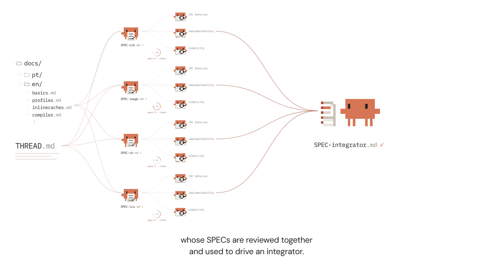

# JITCache

JITCache lets bun save jit code and all its related state to disk resulting in ~2x faster runs for a small cost in the beginning of each function.

## Getting started

### Bun

JITCache ships as a Bun (1.4.2 :) build for Linux, x86_64 and ARM64:

```sh
curl -fsSLO https://github.com/Davi-ldc/bun/releases/download/bun-v1.4.2-jitcache-v1/bun-linux-x64.zip
unzip bun-linux-x64.zip && export PATH="$PWD/bun-linux-x64:$PATH"
```

To generate a cache, run:

```sh
bun --jitcache[=<dir>] --jitcache-mode=p run server.ts
```

`p` creates the cache (default dir is `./.jitcache`) and saves each function's JIT code as it is compiled. To use the cached code:

```sh
bun --jitcache[=<dir>] --jitcache-mode=c/p-c run server.ts
```

`c` (default), just uses the cache. `p-c` also writes, updating when it learns more[^1]. Every write is atomic, so N processes can read a cache while someone writes to it. 

If the cache came from untrusted code, use `strict` to check every body before consuming: [^2]

```sh
bun --jitcache --jitcache-strict run server.ts
```

to maintain the artifact, you can:

```sh
bun jitcache compact 0.25 [<dir>]   # evict a quarter of the bytes
bun jitcache clean [<dir>]          # remove the files of writes that never finished 
```

### Other hosts

If you are embedding JSC, drive JITCache through `JavaScriptCore/JITCacheAPI.h` and configure each `JSC::VM` right after creating it, before its first global object, holding the VM's API lock:

```cpp
#include <JavaScriptCore/JITCacheAPI.h>

JSC::JSLockHolder lock(vm);
JSC::JITCache::Config config;
config.artifactPath = "/var/cache/my-app"_s;         // --jitcache=<dir>
config.role = JSC::JITCache::Role::ConsumerProducer; // --jitcache-mode: Consumer, Producer or ConsumerProducer
config.strict = false;                               // --jitcache-strict
auto started = JSC::JITCache::start(vm, config);     // Started, Busy, Rejected or Fault
```

Before stopping a VM, you can call `delta(vm)` to save what each function learned since the last save [^3] (holding its API lock). 

## Why

JavaScript engines like JavaScriptCore and V8 have some of the best compiler tech in the world. To get close to high-performance statically typed languages like C, the engine records information about the types (and internal structures) while interpreting your code, and after a certain threshold it compiles progressively more optimized code (divided in 4 tiers), speculating that the types will stay stable.


[This post](https://webkit.org/blog/10308/speculation-in-javascriptcore/) from [@filpizlo](https://x.com/filpizlo) explains it :)

The mechanism is incredible, but it was designed to serve the browser with ephemeral tabs and state-dependent code. Even though, today, [two-thirds of developers use JavaScript](https://survey.stackoverflow.co/2025/technology) and [it powers a third of every lambda function](https://www.datadoghq.com/state-of-serverless-2021/). Every instance has to climb the optimisation mountain from scratch, and all the knowledge it collects is thrown away when it dies, or ignored when other workers start. JITCache solves that.


## How 

### it was made

[](docs/images/making-of.mp4?raw=true)

That was heavily inspired by [Jarred's PR adding threads to JSC](https://github.com/oven-sh/WebKit/pull/249). The coolest thing in it are the workflow's details:

<details>

<summary>Writing THREAD.md</summary>

* Beyond taking every hard decision and leaving no loose ends, the most important thing is keeping your intentions clear, especially long-term ones (they become constraints), and making sure you didn't leave any gaps.
* THREAD only gets edited by a human, workflow agents can write reports requesting changes or pointing errors but you gotta keep control over it.
* Priorities are defined in order and I tweak them whenever an agent makes a wrong tradeoff
* I reviewed it many times double checking boundaries, making it simpler, and improving the reasoning line.

PS: I would guess that it's 80% making a good technical design and 20% making sure that agents understand it

</details>

<details>

<summary>Agents maintaining docs/</summary>

* Every 10 reports, the doc's agent reorganizes and compacts (to under 40k bytes) the file, keeping the line of reasoning clear (it gets messie after many fixes).
* Every report is duble checked, a wrong one usually means that the doc is confusing.
* The docs never use line numbers to better survive webkit bumps.

</details>

<details>

<summary>SPECS</summary>

* Every prompt in the workflow are, max one paragraph long, if you need more than that to explain the task, there's probably a gap in THREAD/SPEC .md
* Every decision changed after a review has its intent explained in SPEC-<lane>-history.md, to save the non-obvious insight.
* To manage context, big subtopics go to sub-SPECs, drained by a human later btween rounds. Jarred capped each SPEC at 40k bytes with a compaction agent after every review round that end up pushing text into files no reviewer read, so i decided to compact them latter
* Anything an agent can't settle, like conflicts btween specs go to report/spec/, drained between rounds by a human.

</details>

<details>

<summary>Compacting specs</summary>

</details>

### it works

A producer records each function's baseline code while JavaScriptCore compiles it, marking every byte that depends on an address, and right after the compile saves it to a file of its own, with the function's bytecode and what the engine learned about it: type profiles, counters, and what each inline cache and call site has seen. Every write is atomic, so a crash never leaves half a function behind, and only one process produces at a time while any number consume. When the producer exits, Bun walks the live functions and saves each one again if it learned more since it compiled.

A consumer that needs a function's bytecode reads it from the cache instead of parsing and generating it. At the function's first call, JITCache copies the saved code into executable memory, patches every recorded byte to this process's addresses, puts the saved profiles and counters back, and runs the function in baseline code from that call on. DFG and FTL, the optimizing tiers, still compile in each process, but they start from the producer's warm state, so they arrive sooner. Only baseline code is saved today; DFG and FTL code come next. A function whose source, options or binary differ misses and runs as it would without JITCache, and a damaged cache turns JITCache off for the process.

## FAQ

### Why not change the emitted code itself?

(to read addresses from a table or to shrink each slot to its shortest encoding)

We measured it. On x86_64, recording emits the same instructions as a normal compile. On ARM64 it adds at most one instruction on opcodes that make up 0.05% of Baseline executions. Each function has about 45 address-dependent spots, patched once at import, and the assembler's own link writers already pick the short branch form when the target is in range. A table would add a load per reference and new instruction forms on both architectures. We will revisit it if patching shows up in import time.

### What happens if the binary, the options or the CPU change?

The cache header records the binary's build ID, the options that change code and the CPU features. A cache that does not match is rejected, and the process runs as if JITCache were off.

[^1]: When a higher tier compiles a function, or when the new copy saw more types in its profiles; on a tie, the one with more inline caches filled wins, then the one closer to its next tier. A new copy comes from the save at exit, or from a recompile after the garbage collector freed the function's `CodeBlock`, the object that holds its JIT state. More in the [docs](./docs/JitCache/).

[^2]: Strict checks that every patched spot holds the instruction the patch expects, that offsets and indexes fall inside the code and the bytecode, and that unused fields are zero. It does not check the instructions between those spots, which run as the producer emitted them.

