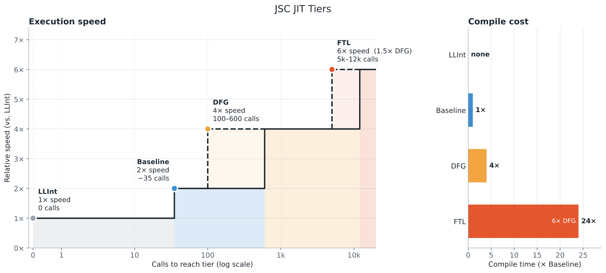

# JITCache

JITCache lets Bun save JIT code and all its related state to disk resulting in ~2x faster runs for a small cost in the beginning of each function.

## Getting started

### Bun

JITCache ships as a Bun (1.4.2 :) build for Linux, x86_64 and ARM64:

```sh
curl -fsSLO https://github.com/Davi-ldc/bun/releases/download/bun-v1.4.2-jitcache-v1/bun-linux-x64.zip
unzip bun-linux-x64.zip && export PATH="$PWD/bun-linux-x64:$PATH"
```

To generate a cache, run:

```sh
bun --jitcache[=<dir>] --jitcache-mode=p run server.ts
```

`p` creates the cache (default dir is `./.jitcache`) and saves each function's JIT code as it is compiled, [then again at exit with what it learned since](#delta). To use cached code:

```sh
bun --jitcache[=<dir>] --jitcache-mode=c|p-c run server.ts
```

`c` (default) just uses the cache. `p-c` also writes, updating when it learns more [^1]. Every write is atomic, so N processes can read a cache while one is writing.

To avoid crashes `--jitcache-strict` adds validation for the full structure of everything we read and the assumptions we make about the current process, costing [bench]

```sh
bun --jitcache --jitcache-strict run server.ts
```

to maintain the artifact, you can:

```sh
bun jitcache compact 0.25 [<dir>]   # evict a quarter of the bytes
bun jitcache clean [<dir>]          # remove the files of writes that never finished 
```

### Other hosts

If you are embedding JSC, drive JITCache through `JavaScriptCore/JITCacheAPI.h` and configure each `JSC::VM` right after creating it, before its first global object, holding the VM's API lock:

```cpp
#include <JavaScriptCore/JITCacheAPI.h>

JSC::JSLockHolder lock(vm);
JSC::JITCache::Config config;
config.artifactPath = "/var/cache/my-app"_s;         // --jitcache=<dir>
config.role = JSC::JITCache::Role::ConsumerProducer; // --jitcache-mode: Consumer, Producer or ConsumerProducer
config.strict = false;                               // --jitcache-strict
auto started = JSC::JITCache::start(vm, config);     // Started, Busy, Rejected or Fault
```

Before stopping a VM, you can call `delta(vm)` to save what each function learned since the last save while holding its API lock ([explanation](#delta))

## Why

JavaScript engines like JavaScriptCore and V8 have some of the best compiler tech in the world. To get close to high-performance statically typed languages like C, the engine records information about the types (and internal structures) while interpreting your code, and after a certain threshold it compiles progressively more optimized code (divided in 4 tiers), speculating that the types will stay stable.



[This post](https://webkit.org/blog/10308/speculation-in-javascriptcore/) from [@filpizlo](https://x.com/filpizlo) explains it :)

The mechanism is incredible, but it was designed to serve the browser with ephemeral tabs and state-dependent code. Yet today, [two-thirds of developers use JavaScript](https://survey.stackoverflow.co/2025/technology) and [it powers a third of all Lambda functions](https://www.datadoghq.com/state-of-serverless-2021/). Every instance has to climb the optimisation mountain from scratch, and all the knowledge it collects is thrown away when it dies, or ignored when other workers start. JITCache solves that.

## How 

### it was made

https://github.com/user-attachments/assets/fe4d86b7-9e90-4d64-b8ef-36aa77349b26

That was heavily inspired by [Jarred's PR adding threads to JSC](https://github.com/oven-sh/WebKit/pull/249). The coolest things in it are the workflow's details:

<details>

<summary>Writing THREAD.md</summary>

* Beyond taking every hard decision and leaving no loose ends, the most important thing is keeping your intentions clear, especially long-term ones (they become constraints), and making sure you didn't leave any gaps.
* THREAD only gets edited by a human, workflow agents can write reports requesting changes or pointing errors but you gotta keep control over it.
* Priorities are defined in order and I tweak them whenever an agent makes a wrong tradeoff
* I reviewed it many times double checking boundaries, making it simpler, and improving the reasoning line.

PS: I would guess that it's 80% making a good technical design and 20% making sure that agents understand it

</details>

<details>

<summary>Agents maintaining docs/</summary>

* Every 10 reports, the doc's agent reorganizes and compacts (to under 40k bytes) the file, keeping the line of reasoning clear (it gets messier after many fixes).
* Every report is double checked, a wrong one usually means that the doc is confusing.
* The docs never use line numbers to better survive webkit bumps.

</details>

<details>

<summary>SPECS</summary>

* Every prompt in the workflow is at most one paragraph long, if you need more than that to explain the task, there's probably a gap in THREAD/SPEC .md
* Every decision changed after a review has its intent explained in SPEC-<lane>-history.md, to save the non-obvious insight.
* To manage context, big subtopics go to sub-SPECs, and we compact them all later. Jarred capped each SPEC at 40k bytes with a compaction agent after every review round, which ended up pushing text into files no reviewer read.
* Anything an agent can't settle, like a SPEC requirement the code can't meet as written, goes to report/spec/, drained between rounds by a human.

</details>

<details>

<summary>Compacting specs</summary>

* Coolest insight is that we plan everything first, thinking of what to cut, based on file's intent (SPEC should be implementable alone, history for whoever revisits a decision), and the order the reasoning should take (following a dependency graph).

</details>

<details>

<summary>implement</summary>

* Implementers never run any slow command (build/git) aadversarial reviewer has a better ROI.
* gaps and problems in thread/specs .md or between lanes are written in report/spec/, read by every later agent, and drained by a human whenever that SPEC is free/not being read by any agent. 
* A design question parks its task. It waits until a human drains the report and answers it in an inbox/, then continues from its saved diff with the answer in its prompt, while every other task goes on.
</details>


### it works

JSC compiles each function independently, starting with the top level, which holds other functions as descriptors (with name and code) that get parsed on the first call. We hook into those points, on the first run of any function (top level included), JITCache checks whether the cache holds a file for it and, if so, loads the machine code, bytecode and engine state ([profiles](./skills/reference/knowledge/common/profiles.md) and [inline caches](./skills/reference/knowledge/common/inlinecaches.md)). If not, it takes the native path.

To be serializable, we take a note of every absolute address, saving what it points to, and emit it in a fixed form [^2] to be relocated later. That way, almost everything goes back to its original state, counters and [profiles](./skills/reference/knowledge/common/profiles.md) are restored and the code stays the same, except for [inline caches](./skills/reference/knowledge/common/inlinecaches.md). They come back empty, as a recipe (bc they hold pointers to objects that might not exist yet) and are recreated on their first use.

<a id="delta"></a> 
`delta(JSC::VM)` saves everything that happened after the compilation (inline caches [make your code faster] and profiles and counters [make the function tier up sooner and better]): it goes through every function the VM holds and updates it in the cache, unless it has a <= version [^3]. Normally, it's called at bun's exit

## Limitations
- currently only baseline, the first tier, can be cached (DFG and FTL are coming soon :)
- producer and consumer need to have the same cpu features, architecture and run the same binary (Bun 1.4.2).
- a bug in JITCache can easily become an RCE
-not every jsc option is supported. Check [options.md](./docs/JitCache/options.md)

## Footnotes

[^1]: `p-c` imports what the cache holds and keeps recording, rewriting functions that compile better code (check [^3]) and adding new ones.

[^2]: The engine normally picks the shortest encoding for each address but, on ARM, the number of instructions depends on the address itself. So, because we dont know where it's gonna be, it always has to be emitted in the full-length form.

[^3]: A version is better when it has seen more, more types in its profiles, array flags and exit sites. Ties go to the one with more inline caches, then to more counter progress, then to the incumbent.